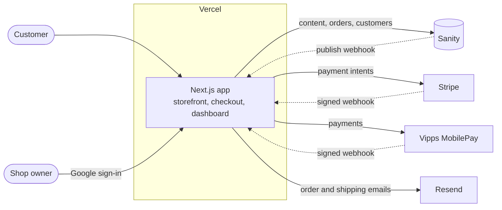

<div align="center">
  <picture>
    <source media="(prefers-color-scheme: dark)" srcset=".github/assets/flora-mark-white.svg">
    
  </picture>

  <h1>Flöra</h1>

  <p>
    The web shop for Flöra: natural fabrics, honest production,<br>
    made to the customer's measurements in Norway.
  </p>

  <p>
    <a href="https://www.prosjectflora.com">prosjectflora.com</a>
  </p>

  <p>
    <sub>Next.js 16 · React 19 · TypeScript · Tailwind CSS 4 · Sanity · Stripe · Vipps MobilePay · Vercel</sub>
  </p>
</div>

<br>

Flöra is a small clothing label, and this is its whole shop in one codebase: the storefront customers
see, the checkout that takes their money, and the dashboard the owner runs the business from. It is
built to be run by one person who is not a developer, so everything that changes from week to week
(products, prices, photos, texts, shipping, discount codes, newsletters) is edited in the dashboard
and never in code.

## Contents

- [What is in it](#what-is-in-it)
- [How it fits together](#how-it-fits-together)
- [How payments are kept safe](#how-payments-are-kept-safe)
- [Tech stack](#tech-stack)
- [Getting started](#getting-started)
- [Project structure](#project-structure)
- [Testing](#testing)
- [Deployment](#deployment)
- [Further reading](#further-reading)
- [Typefaces, photographs and licence](#typefaces-photographs-and-licence)

## What is in it

### Storefront

- **Made to measure.** A product can be sold by the customer's own measurements in centimetres, by a
  fixed list of sizes with stock per size, or with no size at all. Products can have colours, each
  with its own photos.
- **Two languages.** English and Norwegian throughout, switchable anywhere, falling back to English
  field by field where a translation is missing.
- **Pages the owner writes.** Front page, shop, a vintage collection, journal, values, about, FAQ and
  the policy pages are all edited in the dashboard.
- **Customer accounts without passwords.** Customers sign in with a link sent to their email, then
  see their orders and keep their measurements for next time. An order can also be looked up with its
  number and the email it was placed with.
- **Details.** Light and dark theme, page transitions and image loading styles the owner can choose,
  an installable web app manifest, a sitemap, structured product data and generated share images.

### Checkout

- **Cards, Apple Pay, Google Pay and Klarna** through Stripe, in Stripe's own fields.
- **Vipps MobilePay**, integrated directly with the ePayment API.
- **Shipping zones and discount codes**, with prices in NOK and VAT included.
- **Emails** for order confirmation and shipping (with tracking), in the customer's language.

### Dashboard

The owner's side of the shop lives at `/admin`, behind Google sign-in and an allowlist of addresses.

- **Orders**: what to pack, tracking numbers, shipping emails, refunds.
- **Products**: photos, colours, sizing, stock, sale prices, the vintage flag.
- **Content**: every page and text on the site, in both languages, plus a media library that shows
  where each photo and video is used.
- **Newsletters**: a block editor with live preview, sent to every subscriber in their language.
- **Reports**: revenue, visits, live visitors, and exports for accounting.
- **Settings**: shipping, sizing, brand (logo, typefaces, colours), and a switch that keeps the whole
  shop behind a "coming soon" page until it is ready to open.
- **Setup and notifications**: a page that checks every outside service and says, in plain words,
  what is connected and what still needs doing.

## How it fits together



- **One Next.js app** on Vercel serves the storefront, the checkout API routes and the dashboard.
- **Sanity** is the database: products, pages, settings, orders, customers and subscribers are all
  documents there. The storefront reads through one module (`src/lib/catalog.ts`), and a publish
  webhook refreshes the site within seconds of an edit.
- **Stripe and Vipps** hold the money. The app never stores card details.
- **Resend** sends the emails.

## How payments are kept safe

A few rules hold everywhere in the code, and most of the payment code exists to enforce them.

| Rule | How |
| --- | --- |
| Card details never touch this code | They go from the customer's browser straight to Stripe, inside Stripe's own fields. |
| The server decides every amount | The browser may only name products, quantities and a discount code. Prices, shipping, VAT and discounts are worked out on the server from the stored data (`src/lib/pricing.ts`, pure and unit-tested). |
| An order exists only when a payment is proven | Orders are written from Stripe's signed webhook, or after asking Vipps directly for the state of a payment. Never from a page the customer lands on. |
| Nothing is recorded twice | The order's document id is derived from the payment, and the order is written in one transaction together with the stock change, so a repeated delivery changes nothing. |
| Secrets stay on the server | No secret is ever exposed to the browser, and the modules that hold one are marked `server-only`, so importing them from client code fails the build. |
| Misconfiguration is refused, not discovered later | The checkout will not create a payment with mismatched test and live keys, or with live keys and no webhook secret. |

The details, including the layout of the wallet buttons and a go-live checklist, are in
[docs/payments.md](docs/payments.md).

## Tech stack

| Area | Choice |
| --- | --- |
| Framework | [Next.js 16](https://nextjs.org) (App Router, React 19, server actions) |
| Language | TypeScript |
| Styling | [Tailwind CSS 4](https://tailwindcss.com) |
| Content and data | [Sanity](https://www.sanity.io) (Live Content API), with a Studio in `studio/` |
| Payments | [Stripe](https://stripe.com) Payment Element and Express Checkout, [Vipps MobilePay](https://developer.vippsmobilepay.com) ePayment |
| Sign-in | [Auth.js](https://authjs.dev) with Google for the dashboard, emailed links for customers |
| Email | [Resend](https://resend.com) |
| Motion | [GSAP](https://gsap.com), [Lenis](https://lenis.darkroom.engineering), [three.js](https://threejs.org) |
| Analytics | Vercel Analytics, Google Analytics 4 behind a consent choice |
| Tests | [Vitest](https://vitest.dev) |
| Hosting | [Vercel](https://vercel.com) |

## Getting started

You need Node.js 22 or newer, and your own Sanity project and Stripe test keys.

```bash
git clone https://github.com/no-offence-io/project-flora.git
cd project-flora
npm install

cp .env.example .env.local   # then fill in the values, see below
npm run dev
```

The site is then at [http://localhost:3000](http://localhost:3000).

### Environment

Every variable is described in [`.env.example`](.env.example). In short:

| Group | Variables | Needed for |
| --- | --- | --- |
| Sanity | `NEXT_PUBLIC_SANITY_PROJECT_ID`, `NEXT_PUBLIC_SANITY_DATASET`, `SANITY_TOKEN` | Everything. The token is server-only and needs write access. |
| Stripe | `STRIPE_SECRET_KEY`, `NEXT_PUBLIC_STRIPE_PUBLISHABLE_KEY`, `STRIPE_WEBHOOK_SECRET` | Checkout and recording orders |
| Dashboard sign-in | `AUTH_SECRET`, `AUTH_GOOGLE_ID`, `AUTH_GOOGLE_SECRET`, `ADMIN_EMAILS` | `/admin` |
| Email | `RESEND_API_KEY`, `EMAIL_FROM`, `EMAIL_NOTIFY` | Order, shipping and newsletter emails. Without a key nothing is sent, and the dashboard says so. |
| Vipps | `VIPPS_ENV`, `VIPPS_MSN`, `VIPPS_CLIENT_ID`, `VIPPS_CLIENT_SECRET`, `VIPPS_SUBSCRIPTION_KEY`, `VIPPS_WEBHOOK_SECRET` | The Vipps button. Leave empty to hide it. |
| Site | `NEXT_PUBLIC_SITE_URL`, `COMING_SOON`, `PREVIEW_TOKEN`, `REVALIDATE_SECRET` | Links in emails, the coming-soon page, refreshing the site after an edit |

`.env.local` is ignored by git. Real keys belong there and in the host's environment settings, never
in the repository.

### Payments on your machine

Stripe has to reach the webhook for an order to be recorded. The Stripe CLI forwards it:

```bash
stripe listen --forward-to localhost:3000/api/webhooks/stripe
```

It prints a signing secret (`whsec_…`) for `STRIPE_WEBHOOK_SECRET`. Test cards: `4242 4242 4242 4242`
succeeds, `4000 0000 0000 0002` is declined, `4000 0025 0000 3155` asks for 3D Secure.

### Commands

| Command | What it does |
| --- | --- |
| `npm run dev` | Start the development server |
| `npm run build` | Build for production |
| `npm start` | Serve the production build |
| `npm test` | Run the unit tests |
| `npm run lint` | Lint the code |
| `npm run fonts` | Fetch the typefaces (runs by itself before `dev` and `build`) |

The Sanity Studio is a separate small project in [`studio/`](studio): `cd studio && npm install && npm run dev`.

## Project structure

```text
src/
  app/
    (shop)/        The storefront: shop, product, checkout, account, journal, policies
    admin/         The owner's dashboard
    api/           Checkout, payment webhooks, sign-in, revalidation
  components/      Interface components; admin/ holds the dashboard's
  lib/             Pricing, orders, payments, email, translations; admin/ holds reports and media
  sanity/          Read and write clients, generated types
  proxy.ts         The coming-soon gate (Next.js 16's name for middleware)
studio/            Sanity Studio and the content schema
scripts/           One-off and build scripts
docs/              Notes on payments and on content
```

## Testing

```bash
npm test
```

The tests cover the parts where a mistake costs money or trust: pricing, cart lines, money
formatting, what is stored with a payment, the Vipps flow and its webhook signatures, newsletter
rendering and the reports.

## Deployment

The shop runs on Vercel. A push to `main` is a production release; the environment variables above
are set in the Vercel project.

While the shop is closed, every address shows a "coming soon" page. The switch is in the dashboard
(Settings, then Shop status), and a preview link lets invited people see the real site in the
meantime. Payment webhooks and the files Apple Pay needs are always let through.

## Further reading

- [docs/payments.md](docs/payments.md): how money moves, the wallet buttons, Vipps, going live.
- [docs/content.md](docs/content.md): the content model, the dashboard, languages, email and the
  coming-soon gate.

## Typefaces, photographs and licence

Flöra's brand typefaces are commercially licensed and are **not in this repository**. The shop's own
builds fetch them from private storage. Everywhere else, `scripts/fonts.mjs` downloads two
open-licensed stand-ins ([Source Serif 4](https://github.com/adobe-fonts/source-serif) and
[Source Sans 3](https://github.com/adobe-fonts/source-sans), SIL Open Font License) so the project
runs as it is. To use your own, put two `.otf` files at `src/app/fonts/AmericanaStdRoman.otf` and
`src/app/fonts/GothamBook.otf`.

The Flöra name, logo, photographs, films and texts belong to Flöra and may not be reused. The source
code is published so it can be read; no licence to reuse it is granted.

<br>

<div align="center">
  <sub>Designed and built by <a href="https://github.com/no-offence-io">no offence</a> for Flöra.</sub>
</div>
